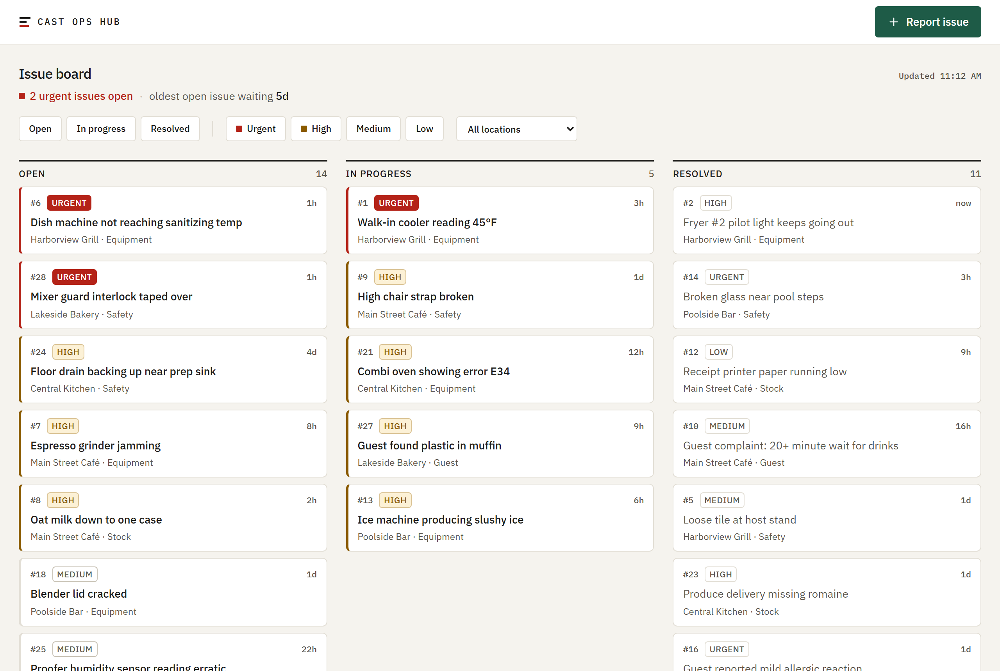
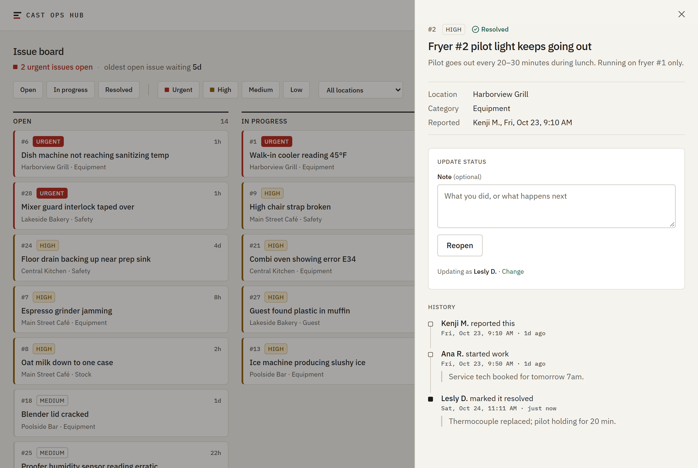
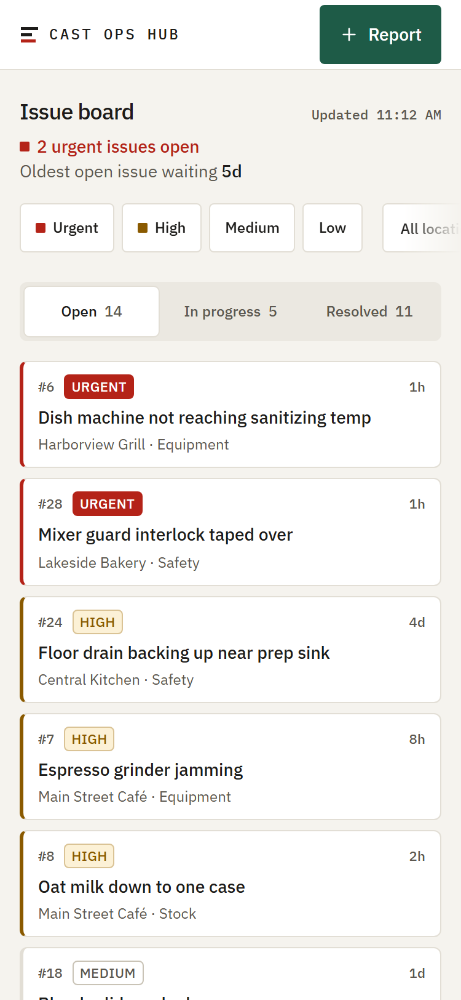
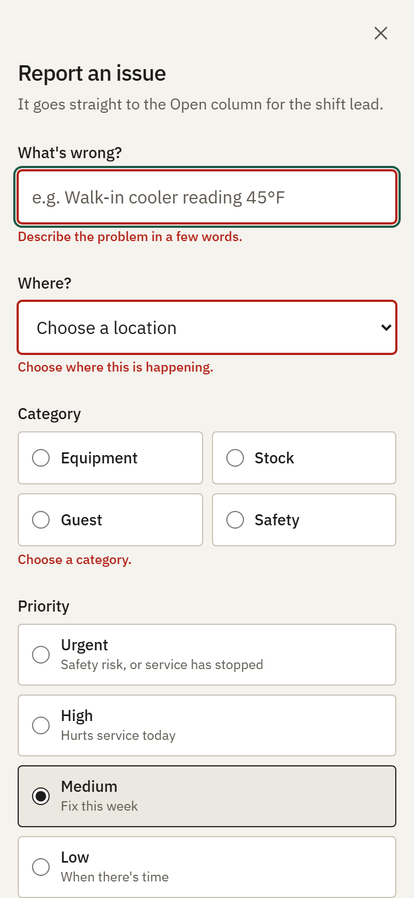
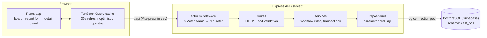
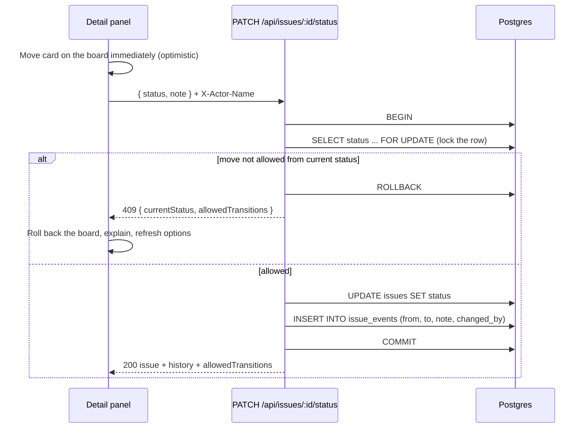
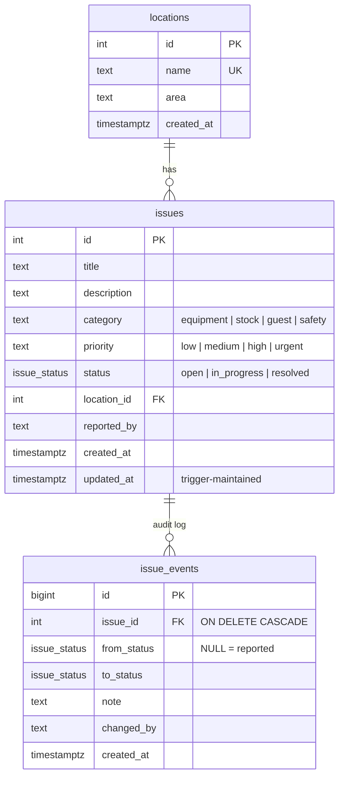

# Cast Ops Hub

[](https://github.com/LeslyDTech/cast-ops-hub/actions/workflows/ci.yml)

Internal issue reporting for restaurant and food & beverage teams.

**Problem → who it helps → what it does.** On a busy shift, problems like a warm walk-in cooler, a broken high chair or a vendor short-ship get reported by shouting across the kitchen, in a group text or on a sticky note. Then they get lost, fixed twice, or never fixed. Cast Ops Hub gives **frontline cast members** a fast way to report an issue from their phone on the floor, and gives **shift leads and managers** one board showing what's open, what's being worked on and what's resolved, across every location. Each report has a category, a priority and a location. Every status change is recorded in an audit trail with who made it, when and why, so the next shift picks up exactly where the last one left off.

> Phase 1 of a portfolio project. Generic sample data, no real company branding.

---

## Screenshots

**Board (desktop).** A one-line shift summary, then three columns with priority readable at a glance. Resolved work steps back visually.



**Issue detail after resolving (desktop).** Status buttons come from the server's allowed moves. The audit history records who, when and why.



| **Board (phone):** column switcher, filters that scroll sideways | **Report form (phone):** large tap targets, errors next to each field |
|---|---|
|  |  |

---

## Features

- **Shift summary** above the board: how many urgent issues nobody has picked up yet, and how long the oldest open issue has been waiting. It follows the location filter but ignores the priority and status filters, so hiding a column never hides an urgent problem.
- **Board** with Open / In progress / Resolved columns. Active columns sort by priority, then by whoever has waited longest. Resolved sorts by most recently fixed.
- **Priority you can't miss.** Urgent and high are shown by color, fill *and* a text label, never color alone. Resolved issues drop the alarm colors.
- **Filters** by status, priority and location. They live in the URL, so a filtered view can be bookmarked or shared.
- **Phone-first report form.** 48px tap targets, a plain-language guide for each priority, and errors shown next to the field.
- **Issue detail panel.** Status buttons come straight from the server's workflow rules (`allowedTransitions`), with an optional note and a timeline of every change.
- **Audit log.** Every status change is written in the same database transaction as the change itself, and the log can only be appended to.
- **Safe under conflict.** If two people move the same issue at once, the database serializes them. The second person sees a clear message and the current options.
- **Built for the floor.** The board refreshes every 30 seconds, cards move instantly when you act, and a failed request rolls back with a visible error.

## Tech stack

| Layer | Choice |
|---|---|
| Frontend | React 19, TypeScript, Vite, Tailwind CSS v4, TanStack Query, React Router |
| Backend | Node.js, Express 5, TypeScript, zod |
| Database | PostgreSQL on Supabase, accessed with `pg` and **plain SQL (no ORM)** |
| Testing | Vitest, Supertest (API tests against real Postgres), Testing Library |
| Repo | npm workspaces monorepo: `client/` and `server/` |

---

## Getting started

### Prerequisites

- Node.js (developed and tested on Node 24) and npm
- A free [Supabase](https://supabase.com) project, or any Postgres 15+ database

### 1. Install

```bash
git clone https://github.com/LeslyDTech/cast-ops-hub.git
cd cast-ops-hub
npm install
```

### 2. Configure the database connection

```bash
cp server/.env.example server/.env      # PowerShell: Copy-Item server\.env.example server\.env
```

In Supabase, open **Connect → Session pooler**, copy the URI, put in your database password, and set it as `DATABASE_URL` in `server/.env`.
Use the **Session pooler**, not "Direct connection": the direct host is IPv6-only, and session mode keeps each transaction on one connection.

`server/.env` is git-ignored. Never commit it.

### 3. Create the tables and sample data

```bash
npm run db:migrate   # applies server/db/migrations/*.sql
npm run db:seed      # 5 locations, 30 issues, realistic histories
```

### 4. Run it

```bash
npm run dev          # API on http://localhost:4000, web app on http://localhost:5173
```

Open http://localhost:5173.

### Scripts (run from the repo root)

| Script | What it does |
|---|---|
| `npm run dev` | Starts the API and the web app together |
| `npm run dev:server` / `npm run dev:client` | Starts just one of them |
| `npm test` | All tests in both workspaces |
| `npm run test:unit` / `npm run test:api` | Server unit tests only (no database), or server API tests only |
| `npm run typecheck` | TypeScript check across both workspaces |
| `npm run db:migrate` | Applies pending SQL migrations |
| `npm run db:seed` | Replaces all data with the sample set |
| `npm run db:reset` | Drops the app schema, re-migrates and re-seeds |

---

## Architecture



Each layer has one job. **Routes** read the request and send the response. **Services** own the business rules and transactions. **Repositories** contain the SQL and nothing else. Repository functions accept either the connection pool or a transaction's connection, so the same SQL runs on its own or inside a transaction.

### How a status change works



### Data model



The workflow lives in one table in [`status-transitions.ts`](server/src/issues/status-transitions.ts):

```
open        → in_progress, resolved
in_progress → open, resolved
resolved    → open            (reopen)
```

### API

All responses are JSON. Success responses look like `{ "data": ... }` and errors like `{ "error": { "code", "message", "details" } }`.
Write requests must send `X-Actor-Name`: the person's name, URI-encoded.

| Method | Path | Notes |
|---|---|---|
| `GET` | `/api/health` | Also checks the database |
| `GET` | `/api/locations` | For the form and filter dropdowns |
| `GET` | `/api/issues?status=&priority=&locationId=` | Every filter is optional and accepts several values, either `a,b` or repeated parameters |
| `GET` | `/api/issues/:id` | The issue plus `events[]` and `allowedTransitions` |
| `POST` | `/api/issues` | Creates the issue and its first audit event in one transaction (`201`) |
| `PATCH` | `/api/issues/:id/status` | `{ status, note? }`; `409` if the move isn't allowed from the current status |

Error codes: `400` validation or bad location · `401` missing actor · `404` not found · `409` move not allowed.

### Project structure

```
cast-ops-hub/
├─ server/
│  ├─ db/migrations/        001–003 *.sql: schema, constraints, triggers, indexes
│  ├─ scripts/db.ts         migrate | seed | reset
│  ├─ src/
│  │  ├─ app.ts             createApp(): no listen(), so tests can import it
│  │  ├─ config.ts          environment variables checked with zod at startup
│  │  ├─ db/                pool, withTransaction(), migration runner, seed
│  │  ├─ issues/            schemas · status-transitions · repository · service · routes
│  │  ├─ locations/
│  │  └─ middleware/        actor (the SSO seam), error handler
│  └─ tests/                unit/ (no DB) · api/ (Supertest + real Postgres)
└─ client/
   └─ src/
      ├─ api/               fetch wrapper (ApiError), query and mutation hooks
      ├─ components/        Panel (<dialog>), PriorityTag, StatusPill, ErrorNotice
      ├─ features/          board · filters · issue-form · issue-detail · identity
      └─ lib/               domain labels, time formatting, shared control styles
```

---

## Testing

```bash
npm test
```

| Suite | Count | What it covers |
|---|---|---|
| Server unit | 66 | Every pair of statuses checked against the workflow, plus reachability. zod schemas: trimming, strict keys, list filters, strict ID parsing. Status-change orchestration with a mocked repository: lock, then update, then event, and nothing written on 404 or 409. |
| Server API | 29 | Supertest against real Postgres: create, list, filter, get and update, plus the 400, 401, 404 and 409 paths. **Rollback is proven:** a trigger makes the audit insert fail after the update, and the test checks nothing changed. **Concurrency:** simultaneous changes must leave a history with no gaps or contradictions. |
| Client | 54 | Filter↔URL round trips, sorting, age formatting, the shift summary. The report form: validation, focus, payload, server errors. The detail panel: only allowed moves shown, PATCH payload and actor header, conflict handling, 404, and focus return when closing. |

The API tests use a separate schema, `cast_ops_test`, in the same database. It is rebuilt from the migration files on every run, so the tests also prove the migrations still apply cleanly. A guard refuses to wipe tables in any schema whose name doesn't end in `_test`.

### Continuous integration

[`.github/workflows/ci.yml`](.github/workflows/ci.yml) runs on every push and pull request:

1. `npm ci`, then the TypeScript check for both workspaces.
2. Starts a throwaway **Postgres 17 container**, so no Supabase credentials are ever stored in CI.
3. Applies the migrations to the fresh database, as their own step so a broken migration fails with a clear error.
4. Runs the server unit and API tests against that database, then the client tests and a production build.

Locally, the same suite runs against Supabase. Set `DATABASE_SSL=false` only for a Postgres without TLS, like the one in CI.

---

## Design decisions

**Data and SQL**
- **Plain SQL with a ~40-line migration runner.** Numbered `.sql` files, one transaction each, tracked in `schema_migrations`. A Postgres lock (an advisory lock) stops two deploys from migrating at once.
- **The database enforces the rules too.**
  - CHECK constraints; a `issue_status` domain (a named type with its own check) shared by three columns.
  - A trigger that keeps `updated_at` current.
  - An append-only trigger on `issue_events`: edits are rejected.

  zod gives friendly errors, and Postgres is the last line of defense.
- **CHECK constraints instead of `ENUM` types.** They're easier to change in a later migration.
- **A dedicated schema, not `public`.** Supabase exposes `public` through its auto-generated REST API. A custom schema keeps this server as the only way in.
- **Injection-safe SQL.** Values are always `$n` parameters, and `= ANY($1::text[])` handles multi-value filters with one fixed query. The schema name, the only identifier pasted into SQL, is validated at startup.

**Workflow and consistency**
- **Status change and audit event commit together.** `SELECT … FOR UPDATE` locks the row, so concurrent changes run one after another and the history never contradicts itself.
- **The server owns the workflow.** Responses include `allowedTransitions`, and the UI renders buttons from it instead of duplicating the rules.
- **The database checks that a location exists.** A failed foreign key becomes a `400`, which avoids a check-then-insert race.

**API**
- **Strict input.** Unknown fields are rejected, so a client can't set `status` or `reported_by`. IDs must be plain digits within Postgres's integer range.
- **One error format.** A central handler turns typed errors into the same response shape everywhere. Express 5 forwards errors from async handlers automatically.

**Frontend**
- **URL as state.** Filters and open panels are part of the URL. Panels are child routes of the board, so links work and closing keeps the filters.
- **Native `<dialog>`.** `showModal()` provides the focus trap, Escape, backdrop and inert background. The app adds focus return, including when a card has moved to another column.
- **Optimistic updates with honest rollback.** Cards move instantly. A conflict or failure restores the board and explains what happened.
- **Accessibility.**
  - Priority and status use text and shape, not just color.
  - Every color pairing was checked against WCAG AA.
  - Focus outlines are visible, tap targets on phones are 48px, and reduced-motion settings are respected.

**Ready for SSO**
- **One seam for identity.** The server's `resolveActor` middleware and the client's `ActorProvider` are the only code that knows where "who is this?" comes from. Microsoft SSO replaces those two pieces, and routes, services and SQL stay the same. `reported_by` and `changed_by` store the name as it was at the time; user ID columns can be added beside them.

**Known Phase 1 tradeoffs**
- Identity is self-reported and stored on the device. This is fine for a demo, and it's the first roadmap item.
- Status, category and priority values are defined in both client and server. They deploy together and the API tests pin the contract; a shared package can come later.
- The issue list is capped at 500 rows with no pagination yet.

---

## Roadmap

| Phase | Item | Plan |
|---|---|---|
| 2 | **CI/CD** | **CI is done:** GitHub Actions runs the typecheck, unit tests, API tests against a temporary Postgres container, and a client build on every push and pull request. **Next, CD:** merges to `main` deploy automatically once deployment is set up. |
| 2 | **Deployment** | API on a managed Node host, static client on a CDN, Supabase Postgres. Migrations run as a release step; health checks use `/api/health`; secrets live in the host's settings, not in files. |
| 3 | **Microsoft SSO** | Sign-in with Microsoft Entra ID (OpenID Connect). Replace `resolveActor` with session-based middleware and `ActorProvider` with the signed-in user. Add `reported_by_user_id` / `changed_by_user_id`, then role-based permissions: cast members report, leads change status. |
| 3 | **Twilio SMS alerts** | Text the on-duty lead when an urgent or safety issue is reported. Messages are queued in an outbox table written in the same transaction as the issue, so no alert is lost or sent twice. Opt-in phone numbers, quiet hours, and a delivery log. |
| 3 | **Nightly reports** | A scheduled job builds a summary per location: new, resolved and still open; oldest open urgent issues; average time to resolve by category. Delivered by email, from SQL views over `issue_events`. |
| Later | Quality-of-life | Pagination, search, photo attachments, assignment, offline-friendly reporting. |
